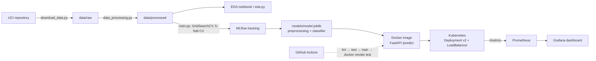

# Heart Disease Risk Prediction — End-to-End MLOps

Binary classifier for heart disease (UCI Heart Disease, Cleveland subset) served as a
monitored REST API on Kubernetes, with experiment tracking and CI/CD.

## Architecture



## Repository layout

| Path | Contents |
|---|---|
| `src/download_data.py` | Fetches the dataset from UCI, saves `data/raw/heart_raw.csv` |
| `src/data_processing.py` | Cleaning: `?`→NaN, numeric types, binary target, dedupe |
| `src/features.py` | Derived feature + impute/scale/one-hot `Pipeline` (shared by training and serving) |
| `src/eda.py`, `notebooks/01_eda.ipynb` | EDA figures → `reports/figures/eda/` |
| `src/train.py` | Grid search for LR / RF / GB, MLflow logging, model selection |
| `src/predict.py`, `notebooks/02_inference.ipynb` | Inference helpers and CLI |
| `api/main.py` | FastAPI app: `/predict`, `/health`, `/metrics`, JSON request logs |
| `tests/` | Pytest suite (offline, synthetic data) |
| `Dockerfile`, `requirements-serve.txt` | Serving image |
| `k8s/` | Namespace, Deployment, LoadBalancer Service |
| `monitoring/`, `docker-compose.yml` | Prometheus + Grafana (dashboard auto-provisioned) |
| `.github/workflows/ci.yml` | CI: lint → test → train → Docker build + smoke test |
| `screenshots/` | Evidence for the report |

## Prerequisites

- Python 3.11
- Docker Desktop with Kubernetes enabled (Settings → Kubernetes → Enable).
  If Docker Desktop offers a choice of cluster type, pick **kubeadm**: it shares the
  local Docker image store, so the cluster can use the image you build without a registry.

## 1. Setup

```bash
python -m venv .venv
# Windows: .venv\Scripts\activate      macOS/Linux: source .venv/bin/activate
pip install -r requirements.txt
```

## 2. Data

```bash
python -m src.download_data      # -> data/raw/heart_raw.csv
python -m src.data_processing    # -> data/processed/heart_clean.csv
```

Commit `data/processed/heart_clean.csv`; CI uses it instead of re-downloading.

## 3. EDA

```bash
python -m src.eda                # all figures, headless
jupyter notebook notebooks/01_eda.ipynb
```

## 4. Train and track

```bash
python -m src.train              # full grids (~1-3 min)
mlflow ui                        # http://localhost:5000
```

Three model families are tuned with stratified 5-fold CV on an 80% training split
(refit on ROC-AUC). Every grid candidate is a nested MLflow run; each family's parent
run holds the best params, CV mean/std for accuracy, precision, recall, F1 and ROC-AUC,
hold-out test metrics, plots (ROC, confusion matrix, feature importance) and the logged
model. The family with the best CV ROC-AUC is saved to `models/model.joblib` together
with `models/metadata.json`; the comparison table goes to `reports/model_comparison.csv`.

## 5. Tests and lint

```bash
flake8 src api tests
pytest -v --cov=src --cov=api
```

## 6. Run the API locally (no Docker)

```bash
uvicorn api.main:app --reload    # http://localhost:8000/docs
python -m src.predict samples/sample_request.json
```

## 7. Docker

```bash
docker build -t heart-disease-api:1.0.0 .
docker run --rm -p 8000:8000 heart-disease-api:1.0.0
curl -X POST http://localhost:8000/predict -H "Content-Type: application/json" \
     -d @samples/sample_request.json
```

PowerShell users: use `curl.exe` instead of `curl`, or open `http://localhost:8000/docs`
and use **Try it out**.

Example response:

```json
{"prediction": 1, "label": "heart disease", "probability_disease": 0.87,
 "confidence": 0.87, "model_name": "...", "model_version": "...", "request_id": "..."}
```

`ca` and `thal` are optional; omitted values are imputed by the saved pipeline
(see `samples/sample_request_low_risk.json`). Invalid input returns HTTP 422.

## 8. Kubernetes (Docker Desktop)

```bash
kubectl config use-context docker-desktop
kubectl apply -f k8s/namespace.yaml
kubectl apply -f k8s/
kubectl -n heart-disease rollout status deployment/heart-api
kubectl -n heart-disease get pods,svc
curl http://localhost:8080/health
curl -X POST http://localhost:8080/predict -H "Content-Type: application/json" \
     -d @samples/sample_request.json
```

After rebuilding the image: `kubectl -n heart-disease rollout restart deployment/heart-api`.
Clean up: `kubectl delete namespace heart-disease`.

If pods show `ErrImageNeverPull` / `ImagePullBackOff`, the cluster cannot see your
local image — check the cluster type note under Prerequisites.

## 9. Monitoring

```bash
docker compose up --build -d
python scripts/load_test.py --url http://localhost:8000 --n 300   # compose API
python scripts/load_test.py --url http://localhost:8080 --n 300   # Kubernetes API
```

- Prometheus: http://localhost:9090 (Status → Targets shows both the compose and k8s APIs)
- Grafana: http://localhost:3000 (admin / admin) → *Heart Disease API - Monitoring*
- Request logs: `docker compose logs api` or `kubectl -n heart-disease logs -l app=heart-api`

Each request is logged as one JSON line (request id, path, status, latency). Prediction
logs record only the outcome and probability, never the patient's clinical values.

Metrics: `api_requests_total`, `api_request_latency_seconds`, `model_predictions_total`,
`model_disease_probability`.

## 10. CI/CD

`.github/workflows/ci.yml` runs on every push to `main` and on pull requests:

1. **lint** — flake8
2. **test** — pytest with coverage; JUnit + coverage reports uploaded as artifacts
3. **train** — full training run; model, `mlruns/` and reports uploaded as artifacts
4. **docker** — builds the image with the freshly trained model, starts it, checks
   `/health`, posts the sample to `/predict` and asserts the response; container logs
   uploaded as artifacts

Each job depends on the previous one, so any lint, test or training failure stops the
pipeline with the failing step's log.
